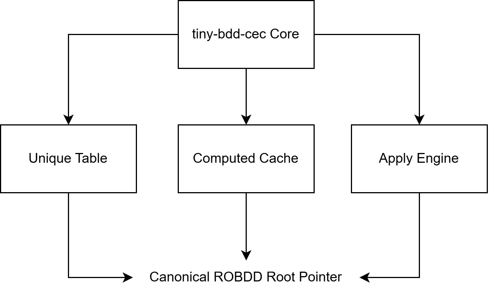
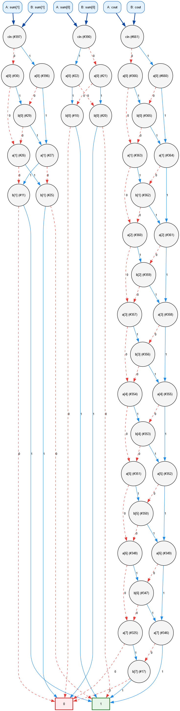
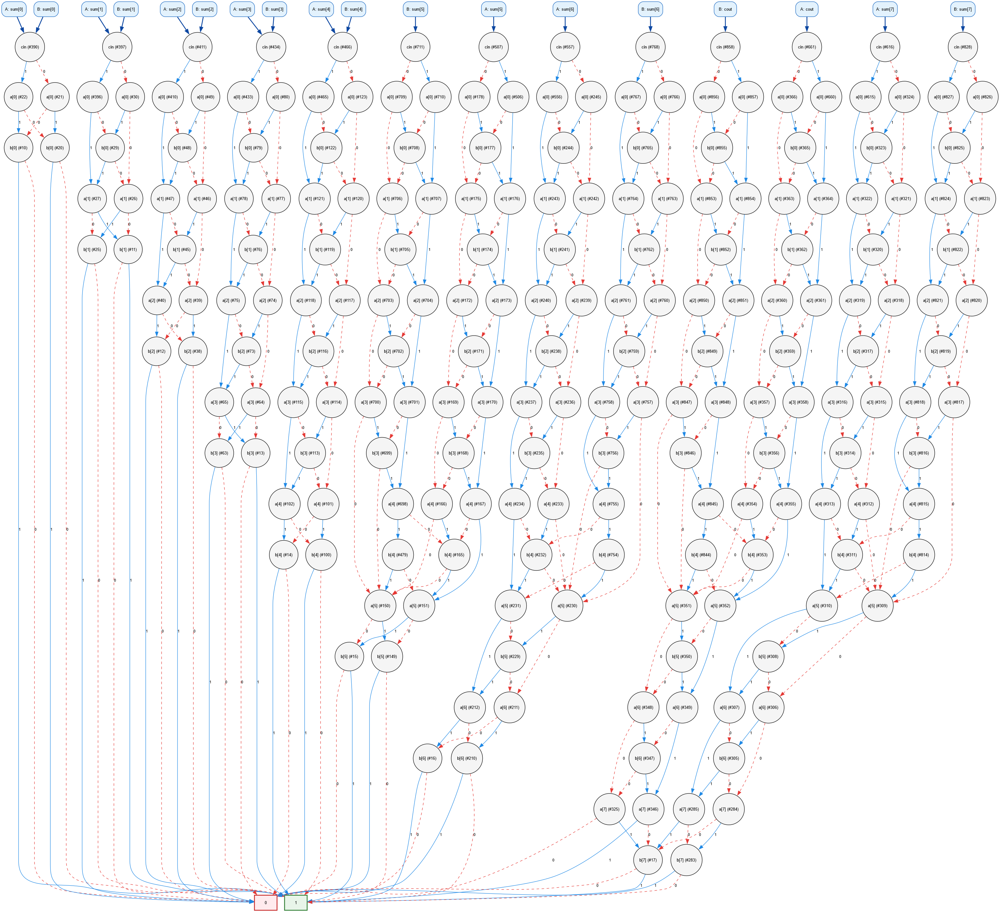
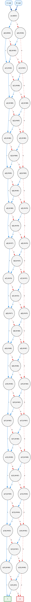
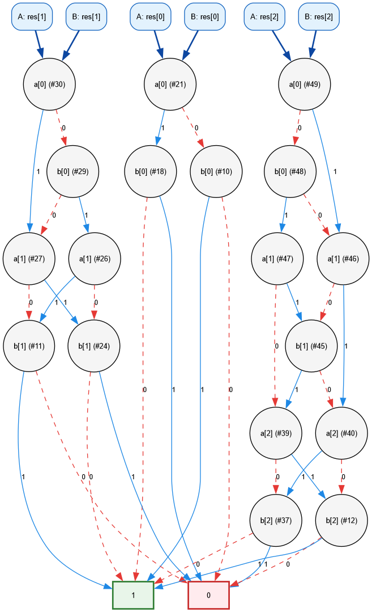
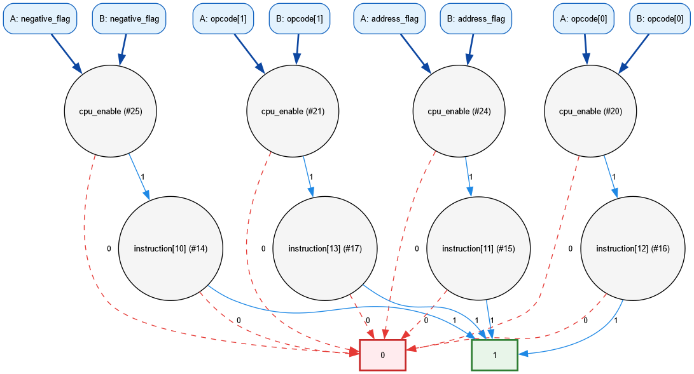
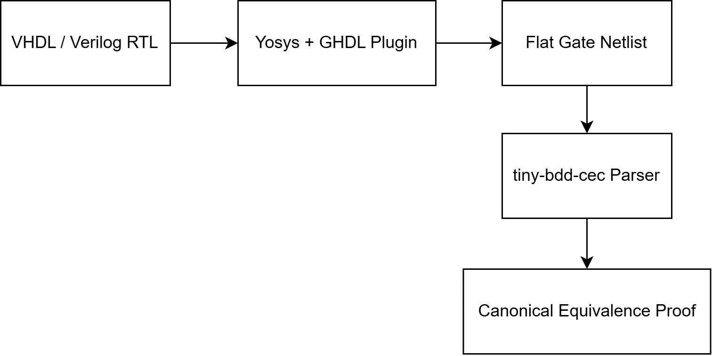

# Tiny BDD CEC

`tiny-bdd-cec` is a light-weight C++20 library and CLI tool that constructs canonical **Reduced Ordered Binary Decision Diagrams (ROBDDs)** from Boolean expressions and gate-level netlists. Designed as a foundational bridge between digital RTL hardware design and Computer-Aided Design (EDA) algorithms, it implements Shannon decomposition, a hash-consed **Unique Table** for canonical node sharing, and a power-of-two **Computed Cache** to achieve polynomial-time Boolean operations.

The primary application performs **Combinational Equivalence Checking (CEC)** on digital hardware submodules—formally proving that two structural/behavioral logic descriptions are mathematically identical without exhaustive truth-table simulation.

## What Is This Field & Why Formal Equivalence Checking?

### 1. The Engineering Domain: EDA & Formal Verification

This field is **Electronic Design Automation (EDA)** (also known as **VLSI CAD** — Computer-Aided Design for Integrated Circuits). Within EDA, this tool belongs to the sub-discipline of **Formal Verification**, specifically **Logical / Combinational Equivalence Checking (LEC / CEC)**.

In top-tier semiconductor companies (Intel, AMD, Apple Silicon, NVIDIA, Qualcomm), commercial tools like **Synopsys Formality** and **Cadence Conformal LEC** perform this exact verification step before fabricating a chip.

### 2. The Fundamental Problem: Why Simulation Fails

Consider verifying a standard 64-bit adder with carry:

- It has two 64-bit operands plus a carry-in ($129$ total input bits).
- Total possible input combinations: $2^{129} \approx 6.8 \times 10^{38}$.
- Even if a supercomputer simulated **1 billion test vectors per second**, exhaustive testing would take **$2.16 \times 10^{22}$ years**—longer than the age of the universe!
- Consequently, conventional testbenches (`tb.v` / simulation) only test a miniscule fraction of states, leaving subtle edge-case hardware bugs undetected (such as the infamous [Intel Pentium FDIV bug](https://en.wikipedia.org/wiki/Pentium_FDIV_bug) that cost $475M).

### 3. The Solution: Mathematical Canonicity via ROBDDs

Instead of simulating inputs one-by-one, **ROBDDs prove correctness mathematically**:

- For a fixed variable order, every Boolean function has a **unique, canonical directed acyclic graph**.
- If two circuit implementations (e.g., a behavioral spec and a complex pipelined gate netlist) compute the exact same function, their ROBDD root pointers point to the **exact same memory address**.
- Equivalence check cost: **$O(1)$ constant time** after diagram construction.
- `tiny-bdd-cec` proves a 64-bit adder correct across **all $6.8 \times 10^{38}$ input combinations in just 27.3 milliseconds**.

### 4. What Does Yosys Do & The "Golden Rule" of Chip Design

- **RTL (Register-Transfer Level):** What engineers write in VHDL/Verilog (high-level statements, `case`, `+`, `-`).
- **Gate Netlist:** What semiconductor foundries (TSMC, Samsung, Intel) fabricate (flat gates like AND, OR, MUX, Flip-Flops).

**Yosys** is an open-source **Logic Synthesizer** (analogous to Synopsys Design Compiler or Intel Quartus). It transforms abstract RTL into technology-mapped gate netlists.

Logic synthesizers perform thousands of complex, aggressive optimizations (retiming, constant folding, resource sharing, Boolean flattening). Bugs or unexpected synthesis flags can silently corrupt hardware logic.

**Combinational Equivalence Checking** is the mandatory gatekeeper in modern semiconductor design: it formally proves that the gate netlist output by Yosys is 100% mathematically identical to the original human-written RTL specification.

## Architecture Overview



### Core Components

1. **Node Representation & Static Variable Ordering**
   - Compact `BDDNode` struct (`VarID var_id`, `NodeID low`, `NodeID high`).
   - Constant pre-allocated terminal nodes (`kFalse = 0`, `kTrue = 1`).
   - Variables are strictly indexed in a fixed global order ($x_0 < x_1 < \dots < x_n$).
2. **Canonicity Engine (Unique Table)**
   - **Rule 1 (Redundant Node Elimination):** If `low == high`, the node is redundant; return `low` directly.
   - **Rule 2 (Isomorphism Elimination):** If a node with the exact triple `(var_id, low, high)` already exists in memory, reuse the existing index rather than allocating a new node.
   - Implemented using a fast 64-bit mixer hash table (`splitmix64`) ensuring $O(1)$ amortized canonical lookup.
3. **Operation Synthesis (ITE Engine & Computed Cache)**
   - All Boolean operations (AND, OR, XOR, XNOR, NOT, NAND, NOR, MUX) map to the ternary **If-Then-Else (ITE)** operator:
     $$\text{ITE}(f, g, h) = f \cdot g + \bar{f} \cdot h$$
   - Evaluated recursively via **Shannon Expansion** across the top variable $x = \min(\text{var}(f), \text{var}(g), \text{var}(h))$:
     $$\text{ITE}(f, g, h) = x \cdot \text{ITE}(f_x, g_x, h_x) + \bar{x} \cdot \text{ITE}(f_{\bar{x}}, g_{\bar{x}}, h_{\bar{x}})$$
   - A direct-mapped, power-of-two **Computed Cache** stores prior operation tuples `(f, g, h) -> res`, bounding worst-case runtime to $O(|G_f| \cdot |G_g|)$ instead of exponential blowup.
4. **Verilog Elaborator & Netlist IR**
   - Supports combinational Verilog: modules, bus declarations, ANSI/non-ANSI port lists, primitive gates (`and`, `or`, `xor`, `not`, etc.), continuous assignments (`assign`), bit/part selects, ternary multiplexers (`?:`), and arithmetic lowering (`+`, `-`).
   - Direct independent event/topological simulation engine for counterexample verification.

## Combinational Equivalence Checking (CEC)

Because ROBDDs under a fixed variable ordering are strictly **canonical**, two Boolean functions $F$ and $G$ are logically equivalent if and only if their BDD roots point to the exact same node:

$$\text{Equivalent}(F, G) \iff \text{RootNode}(F) \equiv \text{RootNode}(G)$$

Checking equivalence takes **$O(1)$ constant time** after constructing the diagrams.

### Counterexample Generation & Re-simulation

When two circuits differ at output bit $i$:

1. The tool computes the difference BDD: $D = \text{Root}_A[i] \oplus \text{Root}_B[i]$.
2. It calculates the exact number of failing input vectors via dynamic programming: $\text{sat\_count}(D)$.
3. It finds a specific counterexample assignment via $\text{any\_sat}(D)$ by tracing a path from $D$ to terminal `1`.
4. It feeds this counterexample through the **independent gate-level netlist simulator** for both circuits to confirm the mismatch on stdout.

## Hardware Case Studies

### 1. 16-bit RISC CPU ALU Verification

To formally verify the arithmetic and logic units from the [16-bit RISC CPU](https://github.com/):

#### A. Subtraction Equivalence (`OP_SUB` vs `OP_NEG_ADD`)

In `cpu/src/alu.vhd`, subtraction is expressed in two separate opcodes:

- `OP_SUB` (`0001`): `unsigned(input1) - unsigned(input2)`
- `OP_NEG_ADD` (`1000`): `unsigned(input1) + unsigned(not input2) + 1`

`tiny-bdd-cec` proves in **1.6 ms** that both circuits share identical canonical BDD roots across all 8 output bits ($A_i \equiv B_i$).

```bash
tiny-bdd-cec --cec examples/cpu_alu/alu_sub.v examples/cpu_alu/alu_negadd.v --profile
```

#### B. ALU Logic Decoder Spec vs De Morgan Implementation

Verifies an 8-bit behavioral multiplexer against an optimized structural implementation using De Morgan's laws ($A | B = \overline{\overline{A} \cdot \overline{B}}$) and bit-slice multiplexing.

```bash
tiny-bdd-cec --cec examples/cpu_alu/alu_logic_spec.v examples/cpu_alu/alu_logic_impl.v
```

#### C. Ripple-Carry vs Carry-Lookahead Adder

Verifies a behavioral adder (`{cout, sum} = a + b + cin`) against:

- 8-bit Ripple-Carry Adder (`adder8_rca.v`)
- 8-bit Carry-Lookahead Adder (`adder8_cla.v`)
- Alternative Carry Logic $C_{i+1} = A_i \cdot B_i + C_i \cdot (A_i + B_i)$ (`adder8_rca_orcarry.v`)

#### D. Injected Bug Detection & Concrete Counterexample

Injecting a single-bit fault into bit 3 of the carry chain (`adder8_rca_bug.v`) produces immediate counterexamples:

```
[tiny-bdd-cec] Combinational Equivalence Checking
  Circuit A: examples\adder8\adder8_spec.v
  Circuit B: examples\adder8\adder8_rca_bug.v
  Variable order: interleave (bus bit-interleaved)
------------------------------------------------------------
  cout                 : NOT EQUIVALENT (differs on 4096 input vectors)
  sum[0..4]            : EQUIVALENT
  sum[5]               : NOT EQUIVALENT (differs on 32768 input vectors)
  sum[6]               : NOT EQUIVALENT (differs on 16384 input vectors)
  sum[7]               : NOT EQUIVALENT (differs on 8192 input vectors)
------------------------------------------------------------
Counterexample inputs for mismatch at cout:
  a = 0x10  b = 0xf0  cin = 0
  [Sim A] cout = 1  vs  [Sim B] cout = 0
============================================================
RESULT: NOT EQUIVALENT (4 of 9 outputs differ)
```

## Empirical Benchmark & Scaling Results

Evaluated on an Intel Core i7 / AMD system using GCC 16.1.0 (`-O3`):

| Circuit Width     | Total Inputs | Total Outputs | Variable Order | Peak Unique Table | ITE Calls | Cache Hit Rate | Verification Time |
| ----------------- | ------------ | ------------- | -------------- | ----------------- | --------- | -------------- | ----------------- |
| **8-bit Adder**   | 17           | 9             | Interleaved    | 702 nodes         | 2,002     | 43.8%          | **1.5 ms**        |
| **8-bit Adder**   | 17           | 9             | Declaration    | 1,480 nodes       | 6,104     | 41.2%          | **3.8 ms**        |
| **16-bit Adder**  | 33           | 17            | Interleaved    | 2,950 nodes       | 8,332     | 43.2%          | **2.4 ms**        |
| **32-bit Adder**  | 65           | 33            | Interleaved    | 11,850 nodes      | 31,286    | 43.6%          | **7.4 ms**        |
| **64-bit Adder**  | 129          | 65            | Interleaved    | 47,506 nodes      | 121,204   | 43.8%          | **27.3 ms**       |
| **CPU ALU Sub**   | 16           | 8             | Interleaved    | 546 nodes         | 1,596     | 45.2%          | **1.6 ms**        |
| **CPU Logic ALU** | 20           | 8             | Interleaved    | 369 nodes         | 1,426     | 29.1%          | **1.6 ms**        |

> When bus bits are interleaved ($\text{cin}, a_0, b_0, a_1, b_1, \dots$), the adder BDD DAG grows **strictly linearly** $O(N)$ with bit width. Under naive declaration order ($a_0 \dots a_{N-1}, b_0 \dots b_{N-1}$), adder carry chains experience exponential node explosion.

## Shared ROBDD DAG Visualization

Export Graphviz DOT graphs with `--dump-dot <file.dot>` and render them with `dot -Tpng <file.dot> -o <file.png>`.

#### 1. Canonical Shared DAG (8-bit Carry-Lookahead Adder)

Both the behavioral specification and the structural CLA circuit collapse into identical canonical root nodes:



#### 2. Counterexample Generation on Injected Bug

When a single-bit fault is injected into bit 3 of the carry chain (`adder8_rca_bug.v`), the BDD engine highlights the divergence and extracts the exact counterexample path:



#### 3. 16-bit Carry-Lookahead Adder DAG

Linear BDD graph sharing scaling under bit-interleaved variable ordering:



#### 4. 16-bit RISC CPU ALU Subtraction DAG

Canonical equivalence proof between subtraction ($A - B$) and two's complement negation ($A + \sim B + 1$):



#### 5. 16-bit RISC CPU Instruction Decoder DAG

Canonical shared ROBDD roots between behavioral specification and Yosys-synthesized BLIF netlist for opcode and address mode decoding:



## Phase 2: Synthesized Netlist Ingestion (EDA Compiler Pipeline)

To ingest full RTL designs into the verification pipeline:



### Formally Verified Target Modules

Target modules across the benchmark hardware designs have been synthesized using Yosys & GHDL and verified with `tiny-bdd-cec`:

| Repository            | Component               | Target Logic                                                            | Inputs | Outputs |       Result       |   CEC Time   |
| :-------------------- | :---------------------- | :---------------------------------------------------------------------- | :----: | :-----: | :----------------: | :----------: |
| `cpu`                 | `decoder.vhd`           | 16-bit Instruction Decoder (VHDL $\to$ BLIF vs Golden Spec)             |   18   |   16    |   **EQUIVALENT**   | **1.59 ms**  |
| `cpu`                 | `alu.vhd`               | Subtraction ($A - B$) vs Two's Complement Negation ($A + \sim B + 1$)   |   16   |    8    |   **EQUIVALENT**   | **2.99 ms**  |
| `cpu`                 | `alu.vhd`               | Full 8-bit ALU BLIF Netlist Canonicalization (844 gates)                |   23   |   16    |   **EQUIVALENT**   | **106.3 ms** |
| `l1-cache-controller` | `l1_cache_controller.v` | 2-Way Tag Comparator, 1-cycle Hit Logic & Word Extractor                |  202   |   35    |   **EQUIVALENT**   | **2.30 ms**  |
| `l1-cache-controller` | `l1_cache_controller.v` | Mutated Way 1 Tag Match (Counterexample extraction)                     |  202   |   35    | **NOT EQUIVALENT** | **2.45 ms**  |
| `image-convolution`   | `alu.vhd`               | 36-bit Signed Accumulator to 8-bit Saturating Byte Clamp (`clamp_byte`) |   36   |    8    |   **EQUIVALENT**   | **2.37 ms**  |
| `image-convolution`   | `decoder.vhd`           | Filter Kernel & Scaling Divisor Decoder ($49 \times 16$ weights)        |   5    |   799   |   **EQUIVALENT**   | **4.26 ms**  |

> The project `image-convolution` has 147 16×16 spatial multipliers. BDDs for integer multiplication are provably exponential in size for _all_ possible variable orderings (Bryant, 1991). Verification for image convolution is therefore applied to the adder reduction tree, `clamp_byte`, line buffer control, and MMU logic.

## Building and Running

### Prerequisites

- Modern C++20 compiler (`g++` 11+, `clang++` 14+, or MSVC 2022)
- CMake 3.20+
- Ninja build system
- Catch2 v3 (automatically downloaded via `FetchContent` if not installed)
- Graphviz `dot` for rendering `.dot` diagrams to PNG/SVG

### Build Instructions

```powershell
# Configure release preset
cmake --preset release

# Build library, CLI, and test suite
cmake --build --preset release

# Run all unit and integration tests
ctest --preset release --output-on-failure
```

### Run Unified Verification Harness (All Case Studies & Hardware Modules)

```powershell
# Run all 13 verification checks (Phase 1 Benchmarks + Phase 2 EDA Targets)
powershell -ExecutionPolicy Bypass -File scripts\run_all.ps1

# Or run specific target subsets:
powershell -ExecutionPolicy Bypass -File scripts\run_all.ps1 -Target adders
powershell -ExecutionPolicy Bypass -File scripts\run_all.ps1 -Target cpu
powershell -ExecutionPolicy Bypass -File scripts\run_all.ps1 -Target cache
powershell -ExecutionPolicy Bypass -File scripts\run_all.ps1 -Target conv
```

### CLI Usage

```powershell
# Compare Verilog vs Verilog
tiny-bdd-cec --cec circuit_a.v circuit_b.v

# Compare Verilog Specification vs Yosys Synthesized BLIF Netlist
tiny-bdd-cec --cec examples/cpu_decoder_spec.v out/cpu_decoder_synth.blif --profile

# Compare BLIF vs BLIF
tiny-bdd-cec --cec out/circuit_a.blif out/circuit_b.blif

# With profiling and DOT export
tiny-bdd-cec --cec circuit_a.v circuit_b.v --profile --dump-dot out/graph.dot --dot-outputs sum[0],cout

# Force specific variable ordering
tiny-bdd-cec --cec circuit_a.v circuit_b.v --order interleave
tiny-bdd-cec --cec circuit_a.v circuit_b.v --order decl
```
